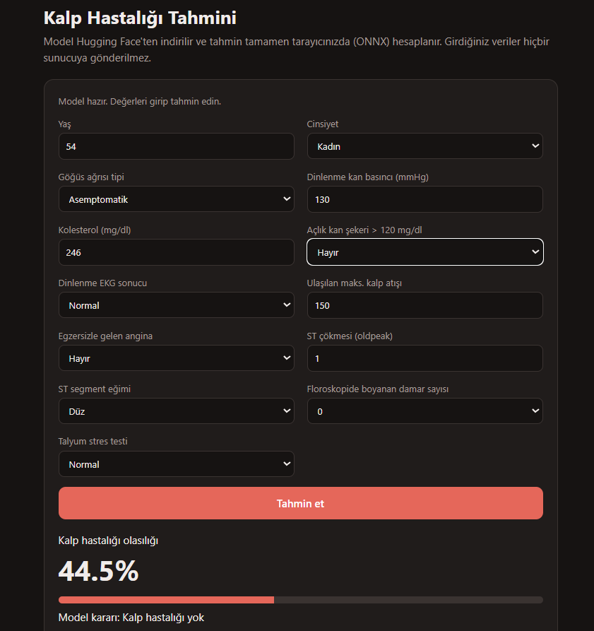
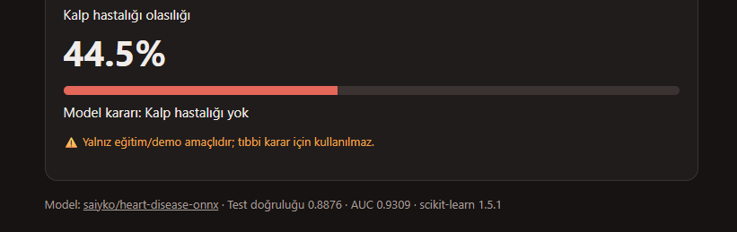

<p align="center">
  
</p>

<p align="center">
  <a href="https://sayko89.github.io/heart-disease-onnx/"></a>
  <a href="https://huggingface.co/saiyko/heart-disease-onnx"></a>
  
  
</p>

# Heart Disease Prediction

**A small heart disease model, hosted for free on Hugging Face and run entirely in the browser.**

Course assignment · Samsun University, Software Engineering · October 2026

1. [The idea](#the-idea)
2. [Links](#links)
3. [How it works](#how-it-works)
4. [What we found in the data](#what-we-found-in-the-data)
5. [Results](#results)
6. [Running it yourself](#running-it-yourself)
7. [The model contract](#the-model-contract)
8. [Design decisions](#design-decisions)
9. [Known limitations](#known-limitations)
10. [Repository layout](#repository-layout)
11. [Assignment checklist](#assignment-checklist)

---

## The idea

The assignment was to rebuild [seyyah/huggingface-hello-web](https://github.com/seyyah/huggingface-hello-web) with our own model: train something locally, publish it on Hugging Face, and use it from a web page.

We picked heart disease. You fill in 13 values from a patient's examination, press one button, and get a probability. The page downloads the model from Hugging Face and does the math in your browser. Nothing you type is sent anywhere.

The model itself is deliberately simple. The pipeline is the point.

> **Not a medical tool.** This is a classroom project trained on a small dataset from the 1980s. Do not use it to make decisions about anyone's health.

---

## Links

| | |
|---|---|
| **Try it** | [sayko89.github.io/heart-disease-onnx](https://sayko89.github.io/heart-disease-onnx/) |
| **Model and model card** | [huggingface.co/saiyko/heart-disease-onnx](https://huggingface.co/saiyko/heart-disease-onnx) |
| **Reference project** | [seyyah/huggingface-hello-web](https://github.com/seyyah/huggingface-hello-web) |
| **Dataset** | [UCI Heart Disease](https://doi.org/10.24432/C52P4X) |
| **Video Link** | https://youtube.com/shorts/aujfkt4OCXU?feature=share |

---

## How it works

```
data/heart.csv
     │  hf_cli.py train      clean → train → export to ONNX → check ONNX matches sklearn
     ▼
_out/model/  model.onnx · config.json · README.md
     │  hf_cli.py push
     ▼
Hugging Face model repo  (free, files served with CORS)
     │  fetch
     ▼
web/index.html on GitHub Pages  →  onnxruntime-web  →  probability
```

**Training** happens on our own machine. A scikit-learn pipeline (`StandardScaler → LogisticRegression`) is trained on 70% of the data and tested on the rest.

**Export.** `skl2onnx` converts the pipeline to a 694-byte `model.onnx`. Right after export the script runs both versions on the test set and stops if they disagree by more than 1e-4. In practice the gap is around 1e-7.

**Hosting.** Hugging Face only stores the files. It does not run anything for us.

**Inference.** The web page reads `config.json`, builds the form from it, loads `model.onnx` with `onnxruntime-web` and runs it locally.

The same reference patient gives **0.4446** everywhere we tested it: scikit-learn, ONNX Runtime in Python, the model downloaded back from Hugging Face, and the browser.

<p align="center">
  <br>
  <sub>The reference patient in the browser. Same number as in Python.</sub>
</p>

---

## What we found in the data

We used the 303-row CSV version of the Cleveland dataset that most tutorials use. Before training anything we compared it with the original UCI files. Two things were wrong.

**The label is flipped.** In this CSV, `target = 1` means *no* heart disease. Patients with `target = 1` have a higher maximum heart rate, less exercise-induced angina and fewer blocked vessels. That is the healthy group. A model trained on the raw column would happily predict the opposite of what the page says. We create our own column, `heart_disease = 1 - target`, and train on that.

**Missing values are disguised as categories.** `ca = 4` and `thal = 0` do not exist in the original data. They are where the missing values used to be. We drop those 7 rows.

That leaves **296 patients: 136 with heart disease, 160 without.**

The category codes were also renumbered compared with the UCI documentation. We matched them back by counting how often each value appears in both versions. For example, chest pain type `0` here is "asymptomatic", which is `4` in the original.

---

## Results

**Held-out test set** (30%, 89 patients)

| Metric | Value |
|---|---|
| Accuracy | 0.888 |
| ROC AUC | 0.931 |
| Precision | 0.970 |
| Recall | 0.780 |
| F1 | 0.865 |

**Confusion matrix**

| | Predicted healthy | Predicted disease |
|---|---|---|
| **Actually healthy** | 47 | 1 |
| **Actually disease** | **9** | 32 |

**5-fold cross-validation** on all 296 patients: AUC **0.907 ± 0.053**, accuracy **0.862 ± 0.051**. With this little data, a single split is lucky or unlucky by a few points, so this is the more honest number.

The headline accuracy hides the important part. The model almost never raises a false alarm, but it misses **9 of the 41** sick patients. For a screening tool that is the wrong way round: a missed patient costs far more than an extra test. A real version would need a lower threshold and would accept more false alarms in return.

The full list of features, their encodings and the model's coefficients are on the [model card](https://huggingface.co/saiyko/heart-disease-onnx).

---

## Running it yourself

You need Python 3.10+ and a free Hugging Face account with a **Write** token.

```bash
pip install -r requirements.txt
hf auth login

python hf_cli.py train                                    # train, export, verify
python hf_cli.py predict                                  # local check, should print 0.4446
python hf_cli.py push --repo YOU/heart-disease-onnx --demo https://YOU.github.io/heart-disease-onnx/
python hf_cli.py hub-predict --repo YOU/heart-disease-onnx
python hf_cli.py pages --repo YOU/heart-disease-onnx      # points the page at your model
```

Then in the GitHub repo: **Settings → Pages → Source: GitHub Actions**. Every push to `main` that touches `web/` republishes the site.

**Trying the page without uploading anything:**

```bash
python hf_cli.py train
python -m http.server 8000
# open http://localhost:8000/web/?base=/_out/model/
```

**On Windows**, if `hf` is "not recognized" after installing, the Scripts folder is not on your PATH. Either add it or use `python -c "from huggingface_hub import login; login()"` instead.

---

## The model contract

Everything that reads the model relies on two files and nothing else.

| File | What it holds |
|---|---|
| `model.onnx` | Input `input`, float32 `[n, 13]`, columns in `config.json` order. Outputs `probabilities`, float32 `[n, 2]`, and `label`. |
| `config.json` | Feature names, display labels, example values, ranges, dropdown options, class labels, metrics, coefficients and library versions. |

The web form is generated from `config.json`. Swap in a different scikit-learn model with the same contract and the page keeps working without a single code change.

---

## Design decisions

| Decision | Why |
|---|---|
| **Logistic regression, not a bigger model** | It is accurate enough on 296 rows, converts cleanly to ONNX, and its coefficients can be read. |
| **Hugging Face as file storage only** | Serverless inference does not support scikit-learn, and Gradio Spaces need a paid account. Model repos are free. |
| **Inference in the browser** | No server to pay for or keep alive, and the patient data never leaves the device. |
| **ONNX, not just the pickle** | `model.joblib` only loads with the exact scikit-learn version and can run arbitrary code. ONNX has neither problem. |
| **Form built from `config.json`** | The page should not need editing every time the model changes. |

---

## Known limitations

- 296 patients from a single US clinic, collected in the 1980s. We have no idea how it would do on patients in Samsun today.
- About two thirds of the patients are men, so predictions for women rest on less data.
- Everyone in the dataset had already been referred for an angiogram. The base rate is much higher than in the general population, so the probabilities do not mean much for screening healthy people.
- Category codes are fed in as plain numbers. A one-hot encoding would be more correct but would make the ONNX contract and the form messier.
- The model file is public. This approach is fine for an open dataset and wrong for a model trained on private patient records.

---

## Repository layout

```
heart-disease-onnx/
├── hf_cli.py                train, predict, push, hub-predict, pages
├── requirements.txt
├── data/heart.csv           raw Cleveland CSV (303 rows)
├── web/
│   ├── index.html           the demo page
│   └── site.json            which Hugging Face repo the page loads
├── docs/                    screenshots for this README
├── .github/workflows/
│   └── pages.yml            publishes web/ to GitHub Pages
└── _out/model/              created by `train`, not committed
```

---

## Assignment checklist

| Deliverable | Where |
|---|---|
| Model trained locally, own dataset | `hf_cli.py train`, `data/heart.csv` |
| Model published on Hugging Face | [saiyko/heart-disease-onnx](https://huggingface.co/saiyko/heart-disease-onnx) |
| Model card | English, with data cleaning, metrics, limitations and usage examples |
| Web page using the model | [Live demo](https://sayko89.github.io/heart-disease-onnx/), `web/index.html` |
| Same result in every runtime | 0.4446 in sklearn, ONNX, Hugging Face download and browser |
| Reproducible from the command line | [Running it yourself](#running-it-yourself) |

---

Dataset: Janosi, A., Steinbrunn, W., Pfisterer, M., & Detrano, R. (1989). *Heart Disease*. UCI Machine Learning Repository. https://doi.org/10.24432/C52P4X (CC BY 4.0).
Structure based on [seyyah/huggingface-hello-web](https://github.com/seyyah/huggingface-hello-web).
