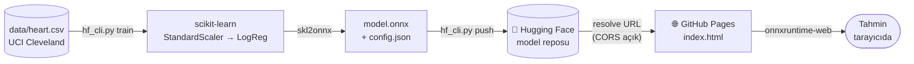

<div align="center">

# 🫀 Kalp Hastalığı Tahmini

**Hugging Face'te barındırılan, tamamen tarayıcıda çalışan bir makine öğrenmesi modeli**

[](https://sayko89.github.io/heart-disease-onnx/)
[](https://huggingface.co/saiyko/heart-disease-onnx)


[Canlı demo](https://sayko89.github.io/heart-disease-onnx/) ·
[Model kartı](https://huggingface.co/saiyko/heart-disease-onnx) ·
[Hızlı başlangıç](#-hızlı-başlangıç) ·
[Nasıl çalışır?](#-nasıl-çalışır)

</div>

<!-- Ekran görüntüsü eklemek için: sayfanın görüntüsünü docs/screenshot.png olarak kaydedin
     ve aşağıdaki satırın başındaki/sonundaki yorum işaretlerini silin.
<p align="center"></p>
-->

> [!WARNING]
> Bu model yalnızca **eğitim ve demo** amaçlıdır. Tıbbi teşhis, tedavi veya herhangi bir klinik karar için **kullanılmaz**.

## ✨ Öne çıkanlar

| | |
|---|---|
| 🔒 **Veri tarayıcıdan çıkmaz** | Tahmin `onnxruntime-web` ile kullanıcının cihazında hesaplanır; hiçbir sunucuya veri gönderilmez. |
| 💸 **Tamamen ücretsiz** | Model Hugging Face Hub'da, site GitHub Pages'te barınır. Sunucu yok, maliyet yok. |
| 🎯 **Her yerde aynı sonuç** | Aynı girdi için scikit-learn, Python ONNX ve tarayıcı **0.4446** verir; dönüşüm her eğitimde otomatik doğrulanır. |
| 🧩 **Kodsuz model değişimi** | Web formu `config.json`'dan üretilir. Yeni model yüklemek için arayüz kodu değişmez. |
| 🧹 **Temizlenmiş veri** | Yaygın CSV sürümündeki ters kodlanmış hedef ve gizli eksik değerler düzeltildi ([ayrıntılar](#-veri-seti)). |

## 📊 Sonuçlar

<table>
<tr>
<td valign="top">

**Test seti** (%30, n = 89)

| Metrik | Değer |
|---|---|
| Doğruluk | **0.888** |
| ROC AUC | **0.931** |
| Precision | 0.970 |
| Recall | 0.780 |
| F1 | 0.865 |

</td>
<td valign="top">

**5-katlı çapraz doğrulama** (n = 296)

| Metrik | Ortalama ± std |
|---|---|
| ROC AUC | 0.907 ± 0.053 |
| Doğruluk | 0.862 ± 0.051 |

**Karışıklık matrisi**

| | Tahmin: yok | Tahmin: var |
|---|---|---|
| **Gerçek: yok** | 47 | 1 |
| **Gerçek: var** | 9 | 32 |

</td>
</tr>
</table>

> [!NOTE]
> Model çok az yanlış alarm veriyor (1), ama gerçekten hasta olan 41 kişiden **9'unu kaçırıyor**. Sağlıkta en pahalı hata bu olduğu için, gerçek bir tarama senaryosunda karar eşiğinin 0.5'in altına çekilmesi gerekirdi.

## 🔄 Nasıl çalışır?



1. **Eğitim (yerelde):** Veri temizlenir, `StandardScaler → LogisticRegression` pipeline'ı eğitilir.
2. **Dönüşüm:** Model `skl2onnx` ile ONNX'e çevrilir; ONNX ve sklearn çıktıları karşılaştırılır (fark ~1e-7).
3. **Barındırma:** `model.onnx`, `config.json` ve İngilizce model kartı Hugging Face'e yüklenir.
4. **Sunum:** GitHub Pages'teki sayfa modeli Hugging Face'ten indirir ve tahmini tarayıcıda yapar.

<details>
<summary><b>Neden Hugging Face Space ya da Inference API değil?</b></summary>

<br>

Hugging Face'in sunucuda çalıştırma seçenekleri (Serverless Inference, Gradio Space) scikit-learn modellerini desteklemiyor ya da PRO hesap gerektiriyor. Model reposu ise ücretsiz ve dosyaları CORS açık URL'lerle sunuyor. Bu yüzden Hugging Face yalnızca **dosya deposu** olarak kullanılıyor, hesaplama tarayıcıda yapılıyor.

</details>

## 🚀 Hızlı başlangıç

**1. Kurulum**

```bash
git clone https://github.com/sayko89/heart-disease-onnx.git
cd heart-disease-onnx
python -m venv .venv
.venv\Scripts\activate           # macOS/Linux: source .venv/bin/activate
pip install -r requirements.txt
hf auth login                    # bir kez — "Write" token: huggingface.co/settings/tokens
```

**2. Eğit → yükle → yayınla**

```bash
python hf_cli.py train                                     # eğit + ONNX + doğrulama
python hf_cli.py predict                                   # yerel test → 0.4446
python hf_cli.py push --repo KULLANICI/heart-disease-onnx \
                      --demo https://KULLANICI.github.io/heart-disease-onnx/
python hf_cli.py hub-predict --repo KULLANICI/heart-disease-onnx   # HF'deki modelle test
python hf_cli.py pages --repo KULLANICI/heart-disease-onnx         # web/site.json'u ayarlar
```

**3. GitHub Pages:** Repo → *Settings → Pages → Source: **GitHub Actions***. Her push'ta [`pages.yml`](.github/workflows/pages.yml) `web/` klasörünü yayınlar.

<details>
<summary><b>Hugging Face'e yüklemeden yerelde denemek</b></summary>

<br>

```bash
python hf_cli.py train
python -m http.server 8000
```

Tarayıcıda: `http://localhost:8000/web/?base=/_out/model/`

Sayfayı başka bir modelle açmak için: `?repo=kullanici/repo`

</details>

<details>
<summary><b>Tüm CLI komutları</b></summary>

<br>

| Komut | Ne yapar |
|---|---|
| `train` | Veriyi temizler, modeli eğitir, metrikleri hesaplar, ONNX'e çevirip doğrular → `_out/model/` |
| `predict` | Yerel ONNX modeliyle örnek tahmin |
| `push --repo R [--demo URL]` | İngilizce model kartını üretir, `_out/model/` klasörünü Hugging Face'e yükler |
| `hub-predict --repo R` | Modeli Hugging Face'ten indirip tahmin yapar |
| `pages --repo R` | Web sayfasının göstereceği modeli `web/site.json`'a yazar |

</details>

## 🧬 Veri seti

[UCI Heart Disease (Cleveland)](https://doi.org/10.24432/C52P4X) verisinin yaygın kullanılan 303 satırlık CSV sürümü; 13 klinik özellik (yaş, cinsiyet, göğüs ağrısı tipi, kan basıncı, kolesterol, EKG, maksimum nabız, talyum testi vb.).

> [!IMPORTANT]
> Bu CSV sürümünde iki bilinen hata var ve `hf_cli.py` ikisini de düzeltiyor:
>
> 1. **Hedef ters kodlanmış:** `target = 1` aslında *hastalık yok* demek. `target = 1` olanlarda maksimum nabız daha yüksek, egzersiz anginası ve tıkalı damar sayısı daha düşük. Bu yüzden açık bir `hastalik = 1 - target` sütunu üretiliyor.
> 2. **Eksik değerler gizlenmiş:** `ca = 4` (5 satır) ve `thal = 0` (2 satır) orijinal veride eksik olan değerler. Bu 7 satır çıkarılıyor → **296 hasta** (136'sı hasta, 160'ı sağlıklı).

Özelliklerin tam listesi, kodlamaları ve model katsayıları [model kartında](https://huggingface.co/saiyko/heart-disease-onnx) yer alıyor.

## 📁 Proje yapısı

```
heart-disease-onnx/
├── hf_cli.py                 # CLI: train · predict · push · hub-predict · pages
├── requirements.txt
├── data/
│   └── heart.csv             # UCI Cleveland (303 satır, ham)
├── web/
│   ├── index.html            # Demo sayfası (onnxruntime-web)
│   └── site.json             # Gösterilecek Hugging Face reposu
├── .github/workflows/
│   └── pages.yml             # web/ → GitHub Pages
└── _out/model/               # train çıktısı (git'e girmez)
    ├── model.onnx
    ├── model.joblib
    ├── config.json
    └── README.md             # Hugging Face model kartı
```

## 📜 Model sözleşmesi

| Dosya | İçerik |
|---|---|
| `model.onnx` | Girdi `input` float32 `[n, 13]` (sıra = `config.features`) → çıktı `probabilities` float32 `[n, 2]` ve `label` |
| `config.json` | `features[{name, label, example, min/max/step \| options}]`, `classes`, `class_labels`, `metrics`, `coefficients`, sürüm bilgileri |

Web formu bu sözleşmeden üretildiği için, `predict_proba`'sı olan ve `skl2onnx`'in çevirebildiği her scikit-learn pipeline'ı arayüze dokunmadan değiştirilebilir.

## ⚠️ Kısıtlar

- Tek bir ABD kliniğinden, 1980'lerde toplanmış 296 hastalık küçük bir veri; diğer popülasyonlara genellenemez.
- Hastaların yaklaşık üçte ikisi erkek; model kadınlar için daha az güvenilir.
- Model dosyası herkese açık ve tahmin istemcide yapılıyor; bu yöntem **gizli hasta verisiyle eğitilmiş modeller için kullanılmamalı**.

## 🙏 Teşekkür ve kaynaklar

- Proje yapısı [seyyah/huggingface-hello-web](https://github.com/seyyah/huggingface-hello-web) örneğinden esinlenmiştir.
- Veri: Janosi, A., Steinbrunn, W., Pfisterer, M., & Detrano, R. (1989). *Heart Disease* [Dataset]. UCI Machine Learning Repository. https://doi.org/10.24432/C52P4X — CC BY 4.0

<div align="center">
<sub>Samsun Üniversitesi · Yazılım Mühendisliği · 2026</sub>
</div>
